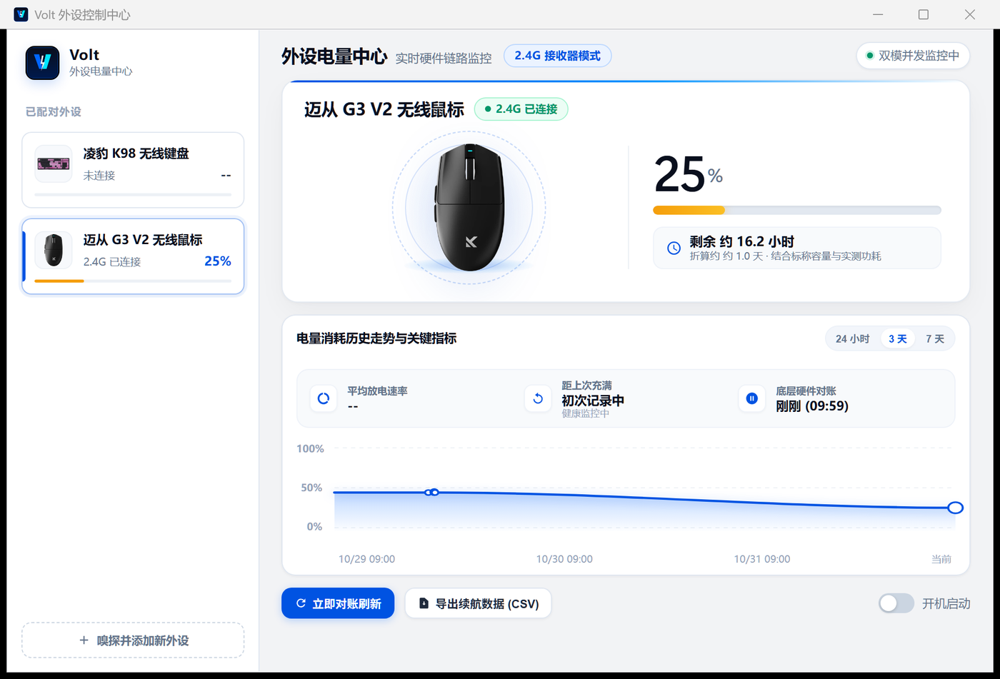

# Volt · 外设电量监控


读取 2.4G 无线键盘 / 鼠标的**真实硬件电量**（不是估算，不是系统给的模糊档位），
常驻托盘显示，带历史曲线、续航估算与低电量提醒。

> Read the **real hardware battery level** of your 2.4G wireless keyboard & mouse on Windows —
> queried directly through vendor-specific HID protocols, with a tray popup, history chart
> and runtime estimates. No cloud, no telemetry. 界面为中文。

<p align="center">
  
</p>
<p align="center">
  
</p>

## 特性

- **真实电量直读**：通过接收器的供应商专有 HID 通道按需查询，秒级返回真值
- **托盘快览卡片**：右键即看全部设备电量，不打断当前工作
- **历史曲线与续航估算**：SQLite 本地落库，按实际耗电斜率动态校准剩余时长
- **低电量 / 充电提醒**：跌破预警线、插电、充满时弹出屏幕悬浮条
- **异常态诚实标注**：设备休眠、缓存读数、样本不足时明确标示，绝不编造数值
- **90 秒新鲜度**：超期读数在主界面灰显「历史读数」，托盘图标转灰，且不触发低电量提醒
- **活动补读**：鼠标/键盘一动就趁机查一次电量（8 秒节流），休眠唤醒不用干等固定轮询周期
- **贴任务栏定位**：托盘卡片用 Windows AppBar 信息定位，任务栏在四边或设为自动隐藏时都不被遮挡
- **添加新外设向导**：内置 HID 嗅探，自动推断电量字节偏移

## 当前支持的设备

| 设备 | 连接方式 | 证据等级 | 状态 |
|---|---|---|---|
| 凌豹 K98 机械键盘 | 2.4G 接收器（Compx 协议，`3554:FA09` / `FF02:0002`） | **A** | ✅ 本机多次实机读数 |
| 迈从 G3 V2 无线鼠标 | 2.4G 接收器（YJX 协议，`3837:4245` / `FF01:0010`） | **A** | ✅ 本机多次实机读数，可与官方驱动共存 |

**证据等级**：A = 本项目实机读数验证；C = 协议已接入但未实机验证；D = 发现但未取得读数，不宣称兼容。
等级只说明验证范围，不代表同品牌全系列可用 —— 同一个 `3554:FA09` 可能被多家厂商的接收器复用，
本项目按「VID/PID + UsagePage/Usage + 产品名」三重精确匹配，身份不符时**不发送任何厂商查询命令**。

完整兼容表（由 `devices/*.json` 自动生成，不会与代码脱节）见 [docs/compatibility.md](docs/compatibility.md)，
各协议的查询帧与解析细节见 [docs/protocols.md](docs/protocols.md)。

## 下载使用

**方式一：直接下载**（推荐）

到 [Releases](../../releases) 页面下载 `Volt.exe`，双击即用，无需安装 Python。

**方式二：源码运行**

```bat
git clone https://github.com/fisher44123/volt-battery-monitor.git
cd volt-battery-monitor
pip install -r requirements.txt
python main.py
```

要求：Windows 10/11 + Python 3.13 + 已安装 [WebView2 Runtime](https://developer.microsoft.com/microsoft-edge/webview2/)（Win11 自带）。

## 数据与隐私

- **完全不联网**：所有数据（电量、历史、设置）只存在本机 `data/` 目录
- 无遥测、无账号、无广告
- 历史记录自动清理 90 天前的明细

## 已知限制

- 设备休眠时收不到电量，界面保留最后已知值并标注「休眠」，晃动设备即可刷新
- 放电速率需要累计 30 分钟以上的活跃放电样本才显示，宁可空着也不给假数字
- 协议按固件版本可能存在差异，如遇同型号不识别欢迎提 issue 附上 `data/volt.log`

## 设备不识别？导出诊断

遇到读不到电量时，先生成一份本机诊断报告（纯本地，不上传任何数据）：

```bat
C://Python313//python.exe scripts\export_diagnostics.py
```

报告会写到 `data\diagnostics-<时间戳>.txt`，包含：所有相关 HID 接口的 VID/PID / 产品名 /
UsagePage / Usage / 接口号、当前设备配置与证据等级、最后已知电量、最近 60 行日志
（本机用户名路径已自动脱敏）。把它贴到 [Issues](../../issues) 里，比一句「读不到」有用得多。

## 添加新设备

```bat
copy devices\template.json devices\<型号>.json
:: 填好 VID/PID、UsagePage/Usage、产品名、协议后：
C://Python313//python.exe scripts\validate_devices.py --write-docs
```

脚本会校验字段格式、ID 与文件名一致性、身份冲突，并自动刷新兼容表；校验失败退出码为 1。

## 从源码打包

```bat
python -m PyInstaller --noconfirm --clean --onefile --noconsole --icon "assets/app_icon.ico" --name Volt --collect-binaries wx --add-data "ui/assets;ui/assets" --add-data "assets;assets" --add-data "devices;devices" --exclude-module matplotlib --exclude-module numpy --exclude-module pandas --exclude-module scipy --exclude-module tkinter --exclude-module test --exclude-module unittest --exclude-module pydoc --exclude-module setuptools --exclude-module pip main.py
```

> 两个打包坑（踩过的）：不要 `--collect-all wx`（体积 30MB→300MB）；
> 但 `--collect-binaries wx` 不能省，否则漏掉动态加载的 `WebView2Loader.dll`，
> 界面全白且零报错。

## 免责声明

本项目对自家设备的 HID 通信做了逆向与实测，仅供个人设备研究与新设备适配参考。
所有协议信息来自社区实测，不保证覆盖同型号的所有固件版本，亦与任何厂商无关。
使用产生的任何后果由使用者自行承担。

## License

[MIT](LICENSE)
